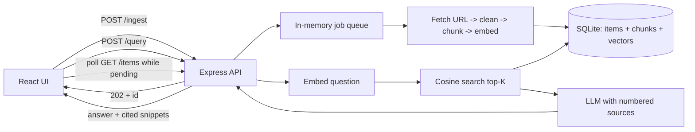

# AI Knowledge Inbox

Save short notes or web pages, then ask questions and get answers generated from **your saved content only**, with cited source snippets. A small RAG app: React + Express + SQLite, runnable locally with **no API key** (a deterministic mock provider is built in).

> Add a screenshot or GIF here before submitting: `docs/demo.gif`.

## Quick start

Requires Node 20+.

```bash
cp .env.example .env      # optional; the app runs without it
npm install
npm run dev               # API on :3001, web on http://localhost:5173
```

- **No key:** runs in `mock` mode (hash-based embeddings, extractive answers). Good for demos and tests, not real semantic quality.
- **Real answers:** put `OPENAI_API_KEY=sk-...` in `.env` and restart. The startup log prints the active provider.

```bash
npm test            # server (Vitest + Supertest) and web (React Testing Library)
npm run typecheck
npm run eval        # tiny retrieval eval: hit-rate@3 over sample notes
```

## How it works



**Ingest:** `POST /ingest` validates, stores the raw item as `pending`, returns `202` immediately and processes in the background (concurrency 2): fetch (URLs only) -> extract text -> chunk -> embed in batches -> store -> `ready`. Transient failures (timeouts, 5xx, 429) retry 3 times with exponential backoff; permanent failures mark the item `failed` with a readable message and a Retry button. Items left `pending`/`processing` by a crash are re-queued at startup.

**Query:** embed the question, brute-force cosine search, drop chunks below a similarity threshold, cap 3 chunks per item, build a numbered context under a size budget, call the LLM, parse the `[n]` markers actually used, and return cited sources first and "also retrieved" after. If nothing clears the threshold the LLM is **not called** and the answer is "I couldn't find that in your saved content."

## API

All errors use `{ "error": { "code", "message", "details"? } }` and every response carries `x-request-id`.

| Endpoint | Purpose | Success | Errors |
|---|---|---|---|
| `POST /ingest` | `{type:"note",content}` or `{type:"url",url}`, optional `title` | `202 {id,status}` | 400 validation, 409 duplicate URL (`details.existingId`), 413, 422 private/unfetchable URL, 429 |
| `GET /items?limit=&offset=` | Newest first: id, sourceType, title, url, status, errorMessage, createdAt, contentPreview, chunkCount | 200 | 400 |
| `GET /items/:id` | Same plus `rawContent` | 200 | 404 |
| `DELETE /items/:id` | Removes item and its chunks | 204 | 404 |
| `POST /items/:id/retry` | Re-process a failed item | 202 | 404, 409 |
| `POST /query` | `{question (3-1000 chars), topK? (1-10, default 5)}` | 200 `{answer, sources[], meta}` | 400, 429, 502/504 upstream AI failure |
| `GET /health` | `{status, db, provider}` | 200 | |

```jsonc
// POST /query -> 200
{
  "answer": "Paris is the capital of France. [1]",
  "sources": [{ "itemId": "...", "chunkId": "...", "title": "Geography", "url": null,
                "snippet": "Paris is the capital of France...", "score": 0.82, "marker": 1, "cited": true }],
  "meta": { "retrievedChunks": 1, "latencyMs": { "embed": 3, "retrieve": 1, "generate": 420, "total": 430 }, "provider": "openai" }
}
```

## Design decisions and tradeoffs

- **Chunking:** recursive split (paragraph -> sentence -> word) to about 400 tokens (estimated as chars/4) with about 50 tokens of overlap. Sentence boundaries keep each chunk coherent, overlap protects facts that straddle a boundary, and 400 tokens is small enough for precise retrieval but large enough to carry context. Short notes become one chunk. The note/page **title is prefixed to the text sent for embedding** (not stored or displayed) so terse chunks keep their context. Tradeoff: token counts are estimates; a real tokenizer would be more exact.
- **Vector store:** embeddings are Float32 BLOBs in SQLite and search is an in-process brute-force cosine scan behind a `VectorStore` interface. One file, zero infrastructure, exact results, and plenty fast for thousands of chunks. Swapping in sqlite-vec, pgvector or a hosted DB only touches `sqliteVectorStore.ts`.
- **Async ingestion:** `202` plus an in-process job runner instead of blocking the request on network and embedding calls. No broker to operate; the cost is that the queue is not durable (mitigated by DB-backed crash recovery on boot).
- **Polling vs SSE:** the UI polls `GET /items` every 2s only while something is pending/processing. Simple, stateless, and stops by itself. SSE would be nicer at scale.
- **"No answer" threshold:** below the similarity threshold the LLM is skipped. This saves cost and prevents confident answers built on irrelevant context. Threshold defaults differ per provider (`MIN_SCORE` overrides) and should be tuned on real data.
- **Prompt-injection posture:** sources are delimited and labelled untrusted data, the system prompt forbids following instructions inside them, and the model must answer only from them and cite.
- **URL safety (SSRF):** only http(s); the hostname is resolved and every address must be public (blocks loopback, RFC1918, link-local/cloud metadata, CGNAT, IPv6 ULA); redirects are followed manually (max 3) with the check repeated per hop; 10s timeout, 2 MB cap, `text/html` and `text/plain` only. Known gap: a DNS-rebinding race between the check and the connection (see production notes).
- **Embedding model pinning:** each chunk stores its `embedding_model`; search ignores chunks from a different model and logs a warning, so vectors from different models are never compared.

## What breaks at scale

- Brute-force search is O(N) per query and loads every vector into memory; fine for thousands of chunks, not millions.
- One process, one SQLite writer: no horizontal scaling, and write contention under heavy ingestion.
- The in-memory queue and per-IP rate limiter are per process; they would not coordinate across instances.
- Embedding/LLM rate limits and cost; no caching of embeddings or answers.
- Large pages, JavaScript-rendered sites and paywalls extract poorly; no re-fetching of stale pages.
- Changing the embedding model requires re-embedding everything (no migration tool yet).

## What I would change for production

Auth and multi-tenancy (`user_id` on every row and query); a real queue and workers (BullMQ/SQS); Postgres with pgvector or a managed vector DB; hybrid search (BM25 + vectors) with reranking; object storage for raw content; embedding and answer caching; streamed answers; per-user rate limits; OpenTelemetry tracing; retrieval evals in CI; a headless-browser fetcher honoring robots.txt and pinning the resolved IP to close the DNS-rebinding gap; content-hash dedupe.

## Known limitations

- The mock provider is lexical (bag-of-words), so quality is demo-level.
- Answers are not streamed; the request waits for the full LLM response.
- Single user, no auth, by design for this exercise.
- `npm run typecheck` and tests are included but should be run on your machine after `npm install`.

## Project layout

```
server/src  config, logger, errors, container (composition root), app (factory)
  db/ routes/ schemas/ middleware/
  services/   ingestService, jobRunner, urlFetcher, ssrf, extractText, chunker, retrievalService, prompt, ragService
  providers/  embedding/ (openai, mock) and llm/ (openai, mock)
  vectorstore/ VectorStore interface + SQLite brute-force implementation
server/tests  unit + API integration tests      server/scripts/eval.ts  retrieval eval
web/src       api/ hooks/ components/ (AddItemForm, ItemList, AskForm, AnswerCard, SourceSnippet...)
```
